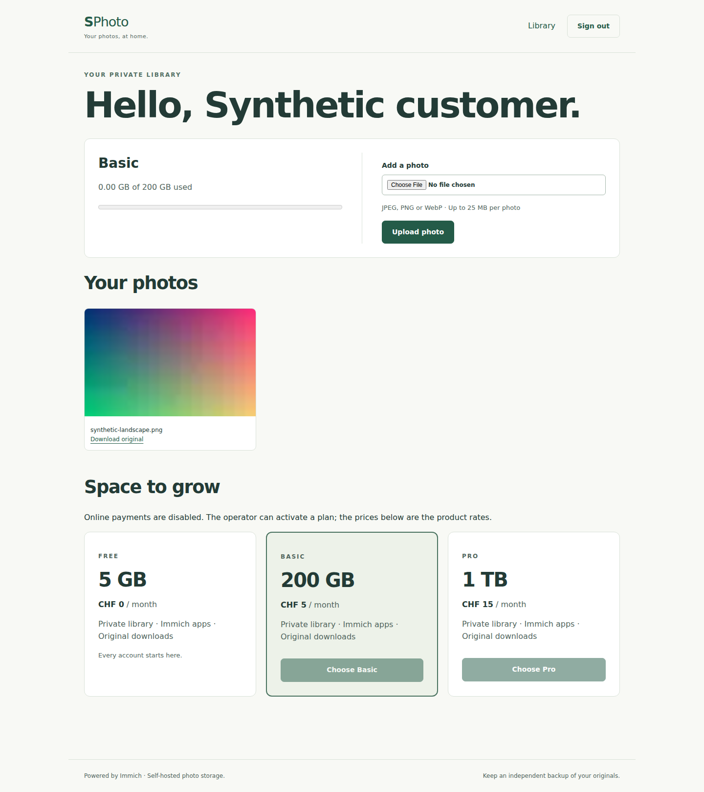

# Verification

GPT-6.1 Sol through Codex in T3 Code performed these checks on 2026-10-19. All
accounts and images were synthetic. No customer data, existing SPhoto deployment,
real Stripe payment, email provider, repository settings or unrelated PR was used.

## dev-t15

All installs, checks, builds and browser processes ran through `capped -m 2G -c 2`.

- `pnpm install --frozen-lockfile`: passed with pnpm 10.18.3 and Node 24.18.1.
- `pnpm check`: passed strict TypeScript, ESLint, seven behavioral test groups,
  and the production TypeScript build.
- `pnpm audit --prod --audit-level high`: no known vulnerabilities reported.
- `actionlint .github/workflows/ci.yml`: passed.
- `git diff --check`: passed. Secret scan of the staged export passed before commit.

The HTTP tests boot the actual SPhoto app and its Immich adapter against a local
HTTP fixture. They cover sign-up/sign-in/out, duplicate accounts, escaped names,
CSRF origin checks, unauthorized routes/admin operations, upload/read isolation,
quota rejection, plan changes, unsafe downgrades, disabled billing and failed job
recovery. SQLite tests close and reopen the database to check encrypted sessions,
expiry/revocation, persisted plans/checkouts and durable event deduplication.

Stripe tests use the official SDK against a synthetic HTTP Stripe API. They cover
checkout and reused open sessions, webhook signature rejection, duplicate event
IDs, current-state ordering, retry after a provider failure, and cancellation that
reduces the quota while retaining existing photo usage and permits a later checkout. These tests do not prove
integration with an actual Stripe account, hosted checkout or Customer Portal.

## Windows desktop

The real stack ran on the native Windows Docker Desktop Linux engine. The Ubuntu
WSL1 distribution was not used. The project was `sphoto-sol`, with loopback host
ports 19000 and 19283 in a dedicated test folder. Docker Desktop was started
without restarting Windows or logging Artur out. A temporary interactive startup
task was removed. Public image pulls used an isolated, anonymous Docker client
configuration because the personal Windows credential helper was unavailable to SSH.

A build and cold start with fresh volumes passed for all four services: app,
Immich v3.3.3, its PostgreSQL/vector image, and Valkey. Compose reported all four
healthy. An idle sample used about 41 MB for SPhoto, 918 MB for Immich, 391 MB for
PostgreSQL and 6 MB for Valkey, within their configured resource limits.

Chromium ran on dev-t15 through a private SSH tunnel to the Windows stack. The
Playwright journey passed against real Immich:

- Landing page, keyboard skip link, sign-up and empty library.
- Upload of a generated PNG; thumbnail rendering and byte-for-byte original download.
- A second customer's empty library, denied access to the first customer's photo,
  and denied access to the operator dashboard.
- Storage rejection through SPhoto and directly through native Immich after
  temporarily lowering only the synthetic customer's quota.
- Operator login, quota repair, Free-to-Basic activation, customer usage update,
  manual job run, and visible successful job result.
- Explicit unavailable-payment response in manual mode, sign-out, bad-password
  error, and successful sign-in.
- A 375 px viewport without horizontal overflow. Axe found no WCAG 2 A/AA or
  WCAG 2.1 AA violations on the landing page and mobile library.

The real browser test caught Chromium sending `Origin: null` under Helmet's
default referrer policy for local HTTP forms. The app now uses `same-origin`
referrer policy while continuing to reject missing/cross-origin POSTs. Axe caught
muted text with contrast below 4.5:1; the corrected color passes. Both checks remain
in the browser suite. These checks are not a complete accessibility audit.

A separate HTTP probe verified that the synthetic account and encrypted browser
session survive an app restart. Stopping only this project's Immich service left
`/health/live` at 200 and returned 503 for readiness/library requests. Restarting
Immich restored the same session and library.

Cleanup removed the `sphoto-sol` containers, volumes, app images, unused upstream
images, test folder and synthetic credentials. Windows and Docker Desktop remain
running. The temporary startup task and private SSH tunnel were also removed.

## Evidence

[Mobile customer library](screenshots/library-mobile.png) and
[operator dashboard](screenshots/operator-desktop.png). The screenshots contain
synthetic account addresses and a generated image only.

## Gaps and release decisions

- Real Stripe test-mode checkout, portal and provider webhook delivery remain
  unverified. No live billing credentials were needed or retrieved.
- No ML entitlement, Nextcloud, dedicated tenant stacks, cross-instance migration,
  custom domains/branding, historical analytics, email alerts, maintenance planner,
  email login/password recovery or self-service account deletion.
- SPhoto's form supports small JPEG/PNG/WebP images. Native Immich handles video,
  large/bulk uploads, albums, removal and bulk export; those richer native-UI and
  mobile-app journeys were not exercised here.
- No production deployment, HTTPS/reverse-proxy integration, restore drill,
  load/capacity test, billing migration, retention implementation or license decision.
- Existing customer data needs an explicit migration; this stack starts fresh.
- GitHub's actual CI result belongs to the PR checks. Local validation alone does
  not establish that GitHub Actions ran successfully.

Review the reduced scope before merging. Public sales need the billing, recovery,
retention, backup and hosting decisions above. The branch does not deploy anything.
